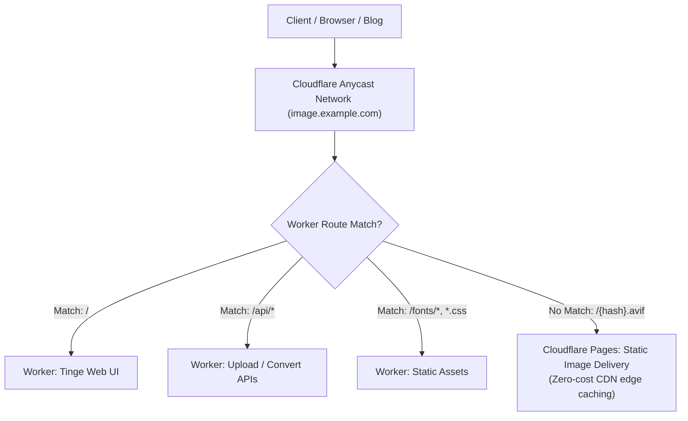

# Tinge: Minimalist Image Management & Processing

Tinge is a premium, high-performance image gateway designed for the Cloudflare ecosystem. It consolidates flexible storage (GitHub & R2), automated AVIF optimization, and a minimalist management interface into a single unified architecture.

With **Single-Domain Edge Routing**, Tinge allows your management interface, API endpoints, and public image delivery to coexist under a single custom domain (e.g., `image.example.com`), backed by **Cloudflare Pages** for zero-cost global CDN distribution and **Cloudflare Workers** for edge management.

## Core Features

- **Unified Single-Domain Architecture**:
  - Leverages Cloudflare Worker Custom Domain for automated DNS & SSL provisioning on your domain (e.g., `image.example.com`).
  - **Zero Cost for Images**: Static images are served via Cloudflare Workers Static Assets and internal Service Bindings without incurring extra invocations.
  - **Unified Entrypoint**: Admin dashboard (`/`), APIs (`/api/*`), and static image files (`/{hash}.avif`) live under the exact same hostname.
- **Dual-Branch & Dual-Worker Microservice Architecture**:
  - `main`: Clean, lightweight codebase for the management Worker (`cloud-image-worker`).
  - `images`: Independent branch storing pure image assets, deployed as a private Assets Worker (`cloud-image-assets`).
  - **Service Binding Connection**: The main worker connects to the assets worker directly in the V8 isolate with 0 network latency.
- **Automated AVIF Processing & Organization**:
  - Automatically converts uploaded or directly pushed media (`jpg`, `png`, `webp`) to high-efficiency **AVIF** format.
  - Organizes media into balanced numbered directories (`1/`, `2/`... strictly 200 images per folder, automatically filling partially filled directories first).
  - Automatically purges junk files (`.DS_Store`, `Thumbs.db`, obsolete `index.html`) and cleans empty directories.
  - Hardlink-powered zero-IO flattening (`cp -l`) before deploying to Cloudflare Pages.
- **Minimalist Management (Chronicle Design System)**:
  - Global configuration bar for Auth and Storage targets.
  - Dual-pane batch drag-and-drop file upload.
  - URL-based remote resource ingestion.
  - Integrated Cloudflare R2 asset manager (list, copy, delete).
- **Token-Based Security**: Robust authentication (`Authorization: Bearer <token>`) enforced across all API and management operations.
- **Serverless Efficiency**: Powered by the Hono framework and WebAssembly image codecs.

## Architecture Overview



## Configuration (Secrets vs Variables)

Configure the following under **Settings > Secrets and variables > Actions**:

### 1. Secrets (Encrypted Credentials)
Place strictly sensitive tokens here. Sensitive secrets used by the Worker (`AUTH_TOKEN`, `GH_TOKEN`) are deployed to Cloudflare as **Encrypted Secrets** via `wrangler secret`:

| Secret Name | Description | Cloudflare Deployment Target |
| :--- | :--- | :--- |
| `CLOUDFLARE_API_TOKEN` | Cloudflare API Token with Workers and Routes permissions. | Used by GitHub Actions runner only. |
| `AUTH_TOKEN` | Custom token for API authentication (`Authorization: Bearer <token>`). | Encrypted Secret in Worker environment. |
| `GH_TOKEN` | GitHub Personal Access Token with repo write scope. | Encrypted Secret in Worker environment. |

### 2. Variables (Plaintext Configuration)
Place non-sensitive identifiers and configs under the **Variables** tab. In Cloudflare, these are deployed as standard plaintext **Environment Variables** (`[vars]`):

| Variable Name | Required? | Description | Default / Auto-detection |
| :--- | :--- | :--- | :--- |
| `DOMAIN` | **Yes** | Custom domain(s) for your Worker. Supports single domain (`image.example.com`) or multiple comma-separated domains (`image.example.com, tinge.example.com`). All listed domains are automatically routed with custom domain SSL. | - |
| `CLOUDFLARE_ACCOUNT_ID` | **Yes** | Your Cloudflare Account ID. | - |
| `GH_BRANCH` | No | Target branch for image uploads. | `images` |
| `GH_USER` | No | GitHub username for the image repository. | Auto-detected from `github.repository_owner` |
| `GH_REPO` | No | GitHub repository name. | Auto-detected from `github.event.repository.name` |
| `WORKER_NAME` | No | Name of the primary Cloudflare Worker. | `tinge` |
| `IMAGE_ASSETS_NAME` | No | Name of the internal static assets Worker. | `tinge-assets` |
| `R2_BUCKET` | **If using R2** | Actual Cloudflare R2 bucket name. Required only if R2 storage is used. | - |

## Setup & Deployment

### 1. Deploy Image Assets Worker (`images` branch)
Push your image assets or trigger the Action on the `images` branch. GitHub Actions will:
- Automatically convert all uploaded images to AVIF format.
- Balance images into folders (200 per folder).
- Deploy the assets directory as a private Cloudflare Worker named `tinge-assets` (or your configured `IMAGE_ASSETS_NAME`).

```bash
git checkout images
git push origin images
```

### 2. Deploy Primary Worker (`main` branch)
Push your code to the `main` branch. GitHub Actions will:
- Bind all your custom domains (`DOMAIN`, e.g. `image.ceda.is, tinge.ceda.is`) to `tinge`.
- Establish an internal **Service Binding** (`IMAGE_ASSETS`) pointing directly to `tinge-assets`.
- Automatically serve web UI, APIs, and image assets under your unified domains with zero network latency.

```bash
git checkout main
git push origin main
```

### 4. Local Development
```bash
npm install
# Prepare local fonts and external styles
./scripts/prepare-fonts.sh
npx wrangler dev
```

## Usage

### Web Interface
Visit `https://image.example.com/` in your browser. Enter your `AUTH_TOKEN` in the configuration bar to unlock management:
- **Dual-Pane Upload**: Drag files into the vacuum on the left and manage your pending queue on the right.
- **Additive Selection**: Add files in multiple batches before processing.
- **Batch Removal**: Remove individual files from the pending list with a single click.

### API Integration
- **Endpoint**: `POST /api/upload` (Form Data) or `POST /api/convert` (JSON)
- **Header**: `Authorization: Bearer {YOUR_AUTH_TOKEN}`

#### JSON Payload Example (`/api/convert`):
```json
{
  "urls": ["https://example.com/photo.jpg"],
  "storage": ["github", "r2"]
}
```

## Design Philosophy
Tinge adheres to the **Chronicle Design System**, prioritizing typography, negative space, and chromatic austerity (one accent color). It utilizes local font hosting and modular CSS to maintain a premium, performant, and privacy-respecting profile.

---

> [!TIP]
> **R2 Storage (Optional)**: If you want to use Cloudflare R2 alongside GitHub, simply set `R2_BUCKET` in your GitHub Variables (or Secrets) to your actual bucket name. The Worker automatically establishes the `R2` binding during deployment.
